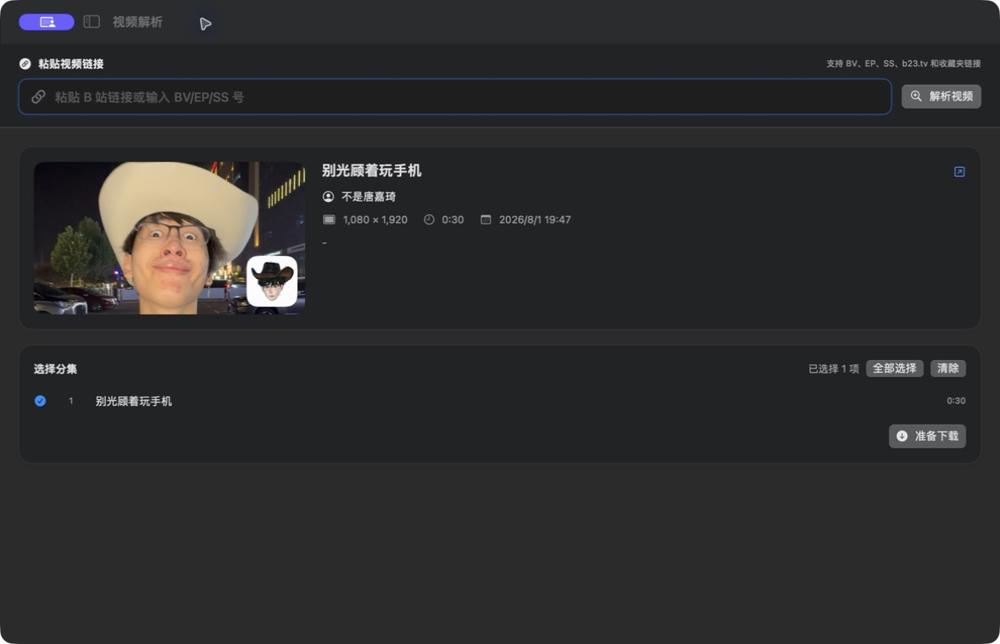

<p align="center">
  
</p>

<h1 align="center">Bilidown for Mac</h1>

<p align="center">
  原生、开源、无需浏览器的 macOS 哔哩哔哩视频下载器。
</p>

<p align="center">
  
  
  <a href="LICENSE"></a>
</p>

<p align="center">
  <a href="https://github.com/Qwehhh2233/bilidown-for-mac/releases/latest"><b>下载最新版本</b></a>
  ·
  <a href="#安装">安装说明</a>
  ·
  <a href="https://github.com/Qwehhh2233/bilidown-for-mac/issues">问题反馈</a>
</p>



> [!IMPORTANT]
> 本项目是基于 [iuroc/bilidown](https://github.com/iuroc/bilidown) 后端制作的非官方 macOS 客户端，与哔哩哔哩官方无关。

## 为什么选择 Bilidown for Mac

Bilidown for Mac 使用 SwiftUI 重写前端，将原项目的网页操作方式变成真正的 macOS 应用：拥有独立窗口、原生文件选择器、程序坞与菜单栏集成，并且不会在启动后打开浏览器。

| | Bilidown for Mac |
| --- | --- |
| 界面 | SwiftUI 原生 macOS 界面 |
| 启动方式 | 独立应用窗口，无需浏览器 |
| 下载管理 | 下载中与已完成分类，支持进度显示 |
| 系统集成 | 原生文件夹选择、文件定位、视频预览、菜单栏状态 |
| 外观 | 浅色、深色、跟随系统 |

## 功能

- 解析 BV、EP、SS、b23.tv、视频合集及收藏夹链接
- 下载视频、音频，或自动合并音视频
- 选择清晰度与分集，批量创建下载任务
- 区分下载中与已完成任务，并显示实时进度
- 使用系统文件选择器设置下载目录
- 在访达中定位文件，并通过 macOS 原生播放器预览
- 哔哩哔哩扫码登录，展示当前账户信息
- 菜单栏显示登录状态和当前下载进度
- 支持浅色、深色及跟随系统外观

## 系统要求

| 项目 | 要求 |
| --- | --- |
| macOS | 13 Ventura 或更高版本 |
| 处理器 | Apple Silicon（M1 或更新） |
| FFmpeg | 必须安装，用于音视频合并 |

Intel Mac 暂未提供预编译版本。

## 安装

### 1. 安装 FFmpeg

如果尚未安装 [Homebrew](https://brew.sh/zh-cn/)，请先按照官网说明安装，然后执行：

```bash
brew install ffmpeg
```

可用以下命令确认安装成功：

```bash
ffmpeg -version
```

### 2. 安装 Bilidown

1. 前往 [Releases](https://github.com/Qwehhh2233/bilidown-for-mac/releases/latest)。
2. 下载 `Bilidown-for-mac-v3.0.1-arm64.zip`。
3. 解压后将 `Bilidown.app` 拖入“应用程序”文件夹。
4. 打开 Bilidown，使用哔哩哔哩 App 扫码登录。

### 3. macOS 阻止首次启动时

当前发布包使用临时代码签名，尚未进行 Apple Developer ID 签名和公证。如果系统阻止启动，请前往：

```text
系统设置 → 隐私与安全性 → 仍要打开
```

请只从本仓库的 Releases 页面下载安装包。

## 使用方法

1. 将视频链接粘贴到“视频解析”。
2. 点击“解析视频”，选择需要的清晰度和分集。
3. 点击“准备下载”。
4. 在“任务列表”查看进度、预览视频或打开文件位置。

应用数据默认保存在：

```text
~/Library/Application Support/Bilidown
```

下载目录可以在应用设置中修改。

## 从源码构建

需要安装 Xcode Command Line Tools、Go 1.23 或更高版本以及 FFmpeg。

```bash
git clone https://github.com/Qwehhh2233/bilidown-for-mac.git
cd bilidown-for-mac
chmod +x scripts/build-app.sh
./scripts/build-app.sh
```

构建结果位于：

```text
build/Bilidown.app
build/Bilidown.app.zip
```

## 项目结构

```text
native/       SwiftUI 原生前端
backend/      Bilidown Go 后端及 API
packaging/    macOS App 元数据与辅助资源
assets/       应用图标与界面截图
scripts/      构建与打包脚本
```

## Roadmap

- [ ] Apple Developer ID 签名与公证
- [ ] Universal Binary / Intel Mac 支持
- [ ] 自动更新
- [ ] 更完整的下载失败诊断

## 反馈与贡献

- 遇到问题：提交 [Bug Report](https://github.com/Qwehhh2233/bilidown-for-mac/issues/new)
- 希望增加功能：提交 [Feature Request](https://github.com/Qwehhh2233/bilidown-for-mac/issues/new)
- 欢迎通过 Pull Request 改进界面、兼容性和文档

报告问题时，请尽量附上 macOS 版本、Mac 芯片型号、复现步骤和错误信息，但不要上传登录凭据或 Cookie。

## 上游项目与许可证

后端源自 [iuroc/bilidown](https://github.com/iuroc/bilidown)，原项目由 iuroc 开发并以 Apache License 2.0 发布。本仓库保留原许可证和署名，并在其基础上加入原生 macOS 前端、后台运行模式、文件处理与 macOS 集成功能。

详情见 [LICENSE](LICENSE) 和 [NOTICE](NOTICE)。本软件仅用于个人学习与合法内容下载；请遵守当地法律、平台服务条款和著作权规定。

---

<sub>English: Bilidown for Mac is an unofficial, open-source Bilibili downloader with a native SwiftUI interface for Apple Silicon Macs. See the sections above for installation and build instructions.</sub>
